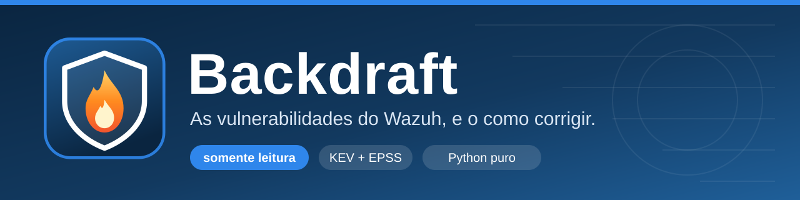
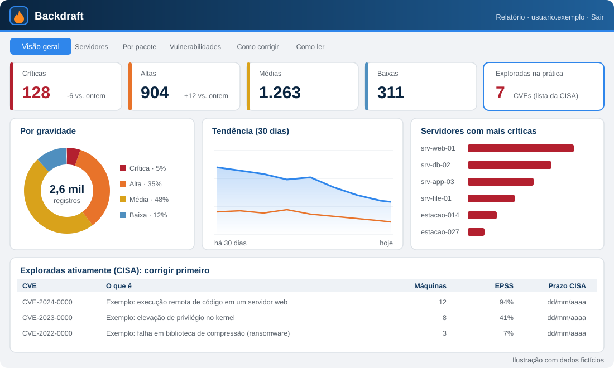
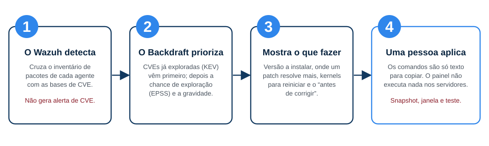
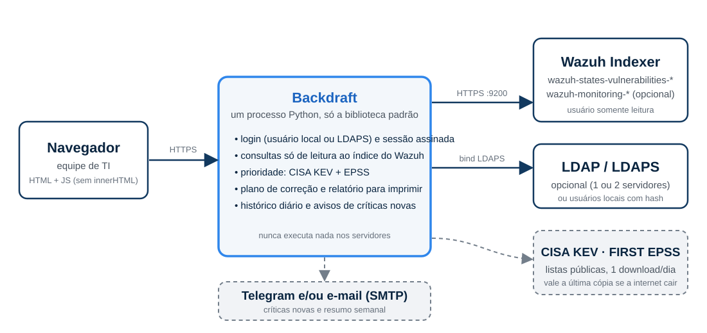

<p align="center">
  
</p>

<p align="center">
  
  
  
  
</p>

**Backdraft** é um painel web **somente leitura** que mostra as vulnerabilidades (CVE) que o [Wazuh](https://wazuh.com) encontrou nos seus servidores e estações, **na ordem em que vale a pena corrigi-las**, e diz **o que fazer**: a versão a instalar, o comando para copiar, o que checar antes e quais máquinas precisam reiniciar.

É um único processo Python, usa só a biblioteca padrão (o `ldap3` só entra se você quiser login por LDAP), não tem banco de dados e **nunca executa nada nos seus servidores**.

> O nome vem do filme *Cortina de Fogo* (*Backdraft*): o backdraft é a explosão de abrir a porta de uma vez para um fogo contido. Corrigir sem backup e sem janela de manutenção é o mesmo erro. Por isso cada máquina tem uma lista **"Antes de corrigir"**.

<p align="center">
  
</p>

---

## Sumário

- [Por que existe](#por-que-existe)
- [O que ele faz](#o-que-ele-faz)
- [Como funciona](#como-funciona)
- [Requisitos](#requisitos)
- [Início rápido](#início-rápido)
- [Instalação passo a passo](#instalação-passo-a-passo)
- [Configuração (`.env`)](#configuração-env)
- [Autenticação](#autenticação)
- [Usando o painel](#usando-o-painel)
- [Relatórios para imprimir e PDF](#relatórios-para-imprimir-e-pdf)
- [Avisos por Telegram e e-mail](#avisos-por-telegram-e-e-mail)
- [Segurança](#segurança)
- [Operação](#operação)
- [Solução de problemas](#solução-de-problemas)
- [Desenvolvimento](#desenvolvimento)
- [Limitações conhecidas](#limitações-conhecidas)
- [Ideias para o futuro](#ideias-para-o-futuro)
- [Licença e créditos](#licença-e-créditos)

---

## Por que existe

A partir do Wazuh 4.8 o detector de vulnerabilidades grava o resultado como um **estado** (índice `wazuh-states-vulnerabilities-*`), não como alerta. Isso tem duas consequências incômodas:

1. As CVEs **não aparecem** no "Last 24 hours alerts" nem geram notificação. Quem não abre o módulo de vulnerabilidades não fica sabendo de uma falha crítica nova.
2. O módulo mostra **o que está errado**, mas pouco do **o que fazer primeiro**: milhares de linhas, sem separar o que já está sendo explorado na prática do que é só teórico.

O Backdraft lê esse índice, cruza com duas listas públicas (CISA KEV e FIRST EPSS) e entrega uma fila de trabalho: *comece por estas CVEs, nestas máquinas, atualizando estes pacotes, assim*.

<p align="center">
  
</p>

---

## O que ele faz

| Aba | O que mostra |
|---|---|
| **Visão geral** | Resumo executivo; indicadores com variação diária; rosca por gravidade; tendência; "tem correção?"; máquinas com mais críticas; por sistema; estações × servidores; **CVEs já exploradas (CISA)**; onde um patch resolve mais; CVEs por ano; kernels (reinício pendente e antigos removíveis); status dos agentes do Wazuh |
| **Servidores** | Uma máquina por linha (tipo, sistema, status do agente, contagem por gravidade). Clicar abre o plano de correção. Dá para marcar várias para gerar um relatório |
| **Por pacote** | Cada pacote/programa somando todas as máquinas: quantas afeta, críticas/altas/médias, **versão a instalar** e 🔥 se tem CVE explorada |
| **Vulnerabilidades** | Busca por CVE ou pacote; filtros por gravidade, máquina, "só com correção" e "só exploradas"; coluna EPSS; **exporta CSV** |
| **Como corrigir** | Por máquina: CVEs exploradas primeiro, checklist **"Antes de corrigir"**, comandos para copiar (`apt`, `dnf`, `snap`), remoção de kernels antigos e notas para Windows |
| **Como ler** | Explica gravidade, 🔥/EPSS, "tem correção?", kernels, de onde vêm os dados e o que o painel **não** faz |
| **Relatório** | Página para **imprimir ou salvar em PDF**: da rede toda, de uma máquina, de uma seleção ou de um grupo. Veja [Relatórios](#relatórios-para-imprimir-e-pdf) |

Extras que trabalham em segundo plano:

- **KEV (CISA) e EPSS (FIRST)**: listas públicas e gratuitas, baixadas uma vez por dia (vale a última cópia se a internet cair). CVE na KEV = já explorada na prática, vai para o início da fila. EPSS = chance de exploração nos próximos 30 dias.
- **Histórico**: uma foto por dia alimenta a curva de tendência e a variação "vs. dia anterior". A rotina horária também compara o conjunto de CVEs críticas para saber o que é **novo** e o que foi **corrigido**.
- **Avisos** por Telegram e/ou e-mail: críticas novas e resumo semanal (desligados até você configurar).
- **Status dos agentes** (ativo/desconectado) lido de `wazuh-monitoring-*`, para o relatório avisar quando o dado de uma máquina pode estar velho.

---

## Como funciona

<p align="center">
  
</p>

- Lê o índice `wazuh-states-vulnerabilities-*` (**um documento por CVE × pacote × máquina**) com um usuário do indexador que só tem permissão de leitura.
- **A versão a instalar** vem de `vulnerability.scanner.condition`:

  | Condição no Wazuh | O que o Backdraft entende |
  |---|---|
  | `Package less than X` | corrigido na versão **X** |
  | `Package less than or equal to X` | existe correção, mas a versão exata é desconhecida |
  | `Package default status` | **sem correção publicada** |

  Com várias CVEs no mesmo pacote vale a **maior** versão (ela resolve todas). A comparação segue a ordem do `dpkg`, que serve para `deb`, `rpm` e versões do Windows.
- **Nunca executa nada** nos servidores. Os comandos são texto, para uma pessoa copiar. E um nome de pacote só entra num comando se for "limpo" (`[A-Za-z0-9.+_:~-]`): o nome vem da máquina inventariada, e uma máquina comprometida poderia informar algo como `x; rm -rf /` para ser copiado e colado por alguém.
- Resultados pesados ficam em cache (padrão 5 min); o Wazuh só reavalia a cada ~1 h.
- Estado em disco (opcional, `BACKDRAFT_ESTADO`): `historico.jsonl`, `criticas.json`, as listas KEV/EPSS baixadas e o estado dos avisos. São arquivos pequenos, gravados de forma atômica. Sem a pasta, tudo funciona só em memória.

---

## Requisitos

| Item | Detalhe |
|---|---|
| Wazuh | 4.8 ou mais novo, com **Vulnerability Detection** ligado. Desenvolvido e testado contra o 4.14 |
| Servidor do painel | Linux com systemd (Ubuntu/Debian testados), **Python 3.10+**, `openssl`. Roda bem num LXC/VM pequeno (1 vCPU, 512 MB) |
| Rede | O servidor do painel precisa alcançar o indexador do Wazuh (porta 9200) e, para KEV/EPSS, a internet (HTTPS de saída) |
| Login | **Usuários locais** (sem nada além do Python) e/ou **LDAP/LDAPS** (precisa do pacote `ldap3`) |
| Navegador | Qualquer um recente. O painel não carrega nada de fora (sem CDN, sem fontes externas) |

---

## Início rápido

```bash
# 1. Copie o projeto para o servidor e instale (como root)
git clone https://github.com/ewertonbsilva/Backdraft.git && cd Backdraft
sudo ./deploy/instalar.sh ana.silva,bruno.souza      # logins autorizados

# 2. Preencha a senha do usuário somente leitura do indexador e copie a CA do Wazuh
sudoedit /opt/backdraft/.env                          # INDEXER_URL, INDEXER_PASS
sudo cp root-ca.pem /opt/backdraft/root-ca.pem        # a de /etc/wazuh-indexer/certs/root-ca.pem

# 3. Crie o login (local, sem LDAP): gera a linha para o .env
python3 /opt/backdraft/backdraft.py --gerar-hash ana.silva
#   cole a linha impressa em LOCAL_USERS=... no .env

sudo systemctl restart backdraft
# 4. Abra https://IP-DO-SERVIDOR:8443  (o certificado é autoassinado, aceite o aviso)
```

Antes disso, **uma vez**, crie no Wazuh o usuário somente leitura ([passo 1 abaixo](#1-criar-o-usuário-somente-leitura-no-indexador-do-wazuh)).

---

## Instalação passo a passo

### 1. Criar o usuário somente leitura no indexador do Wazuh

O Backdraft **só precisa ler**. Crie um papel que enxergue apenas os índices de vulnerabilidade (e, opcionalmente, o de monitoramento, para o status dos agentes). No **Dev Tools** do Wazuh Dashboard (ou com `curl` no servidor do indexador):

```
PUT _plugins/_security/api/roles/backdraft_read
{
  "cluster_permissions": [],
  "index_permissions": [{
    "index_patterns": ["wazuh-states-vulnerabilities-*", "wazuh-monitoring-*"],
    "allowed_actions": ["read"]
  }]
}

PUT _plugins/_security/api/internalusers/backdraft-read
{ "password": "UMA-SENHA-LONGA-E-ALEATORIA", "backend_roles": [] }

PUT _plugins/_security/api/rolesmapping/backdraft_read
{ "users": ["backdraft-read"] }
```

Com `curl` (troque a senha do `admin`):

```bash
curl -sk -u admin:SENHA -X PUT https://127.0.0.1:9200/_plugins/_security/api/roles/backdraft_read \
  -H 'Content-Type: application/json' \
  -d '{"cluster_permissions":[],"index_permissions":[{"index_patterns":["wazuh-states-vulnerabilities-*","wazuh-monitoring-*"],"allowed_actions":["read"]}]}'
```

> `wazuh-monitoring-*` é opcional. Sem ele o painel funciona normalmente e só avisa que o status dos agentes está indisponível.

### 2. Liberar o acesso de rede ao indexador

Por padrão o indexador escuta só em `127.0.0.1`. Se o Backdraft roda em **outra máquina**:

1. No `opensearch.yml` do indexador, deixe-o escutar também no IP da rede do Wazuh, por exemplo `http.host: ["_local_", "192.0.2.10"]`, e reinicie o `wazuh-indexer`.
2. No firewall do servidor Wazuh, libere a **porta 9200 apenas para o IP do Backdraft**:

```bash
sudo ufw allow from 192.0.2.20 to any port 9200 proto tcp comment 'Backdraft'
```

3. Copie a CA do Wazuh (`/etc/wazuh-indexer/certs/root-ca.pem`) para o servidor do Backdraft. O painel valida a **cadeia** do certificado com essa CA e **não confere o nome** (o certificado padrão do indexador só tem `127.0.0.1` no SAN).

### 3. Instalar o Backdraft

```bash
sudo ./deploy/instalar.sh ana.silva,bruno.souza
```

O instalador (pode rodar de novo para atualizar):

- cria o usuário de sistema `backdraft`, sem shell e sem home;
- copia o programa para `/opt/backdraft`, **somente leitura** para o serviço;
- instala o `ldap3` (pelo `apt`, ou `pip --target` como alternativa; `SEM_LDAP=1` pula);
- gera um **certificado TLS autoassinado** (825 dias) em `/opt/backdraft/tls`;
- cria `/opt/backdraft/.env` (permissão `640`) com um `BACKDRAFT_SECRET` aleatório;
- instala e inicia o serviço `backdraft` (systemd, endurecido) e confere `/saude`;
- numa atualização, **preserva** o `.env`, o certificado e os dados, e acrescenta ao `.env` as chaves novas.

### 4. Configurar

Edite `/opt/backdraft/.env`. O mínimo:

```ini
INDEXER_URL=https://192.0.2.10:9200
INDEXER_PASS=a-senha-do-backdraft-read
ALLOWED_USERS=ana.silva,bruno.souza
LOCAL_USERS=ana.silva|pbkdf2_sha256:600000:...     # veja Autenticação
```

A CA do Wazuh vai em `/opt/backdraft/root-ca.pem`. Reinicie: `sudo systemctl restart backdraft`.

### 5. Firewall do servidor do painel

Libere a 8443 só para a rede de administração:

```bash
sudo ufw allow from 198.51.100.0/24 to any port 8443 proto tcp comment 'Backdraft (admin)'
sudo ufw allow from 198.51.100.0/24 to any port 22 proto tcp
```

Além disso, `ALLOWED_IPS` no `.env` restringe pelo próprio painel (defesa em profundidade).

### 6. (Opcional) Atrás de um proxy reverso

Se publicar num subcaminho, ex.: `https://ti.exemplo.com/backdraft/`, defina `BACKDRAFT_BASE=/backdraft` e `TRUSTED_PROXIES` com o IP do proxy (para o painel ler o IP real do cliente em `X-Real-IP`). O painel aceita o prefixo mantido ou removido pelo proxy. Exemplo para nginx:

```nginx
location /backdraft/ {
    allow 198.51.100.0/24;  deny all;                 # restrinja quem chega
    proxy_pass https://127.0.0.1:8443/backdraft/;
    proxy_ssl_verify off;                              # o painel usa certificado autoassinado
    proxy_set_header Host $host;
    proxy_set_header X-Real-IP $remote_addr;
}
```

Mesmo atrás do proxy, mantenha `COOKIE_SECURE=1` e o HTTPS até o painel.

---

## Configuração (`.env`)

Tudo é configurado por variáveis de ambiente. O arquivo comentado está em [`.env.example`](.env.example).

### Servidor

| Variável | Padrão | Para que serve |
|---|---|---|
| `BACKDRAFT_BIND` / `BACKDRAFT_PORT` | `0.0.0.0` / `8443` | onde escuta |
| `BACKDRAFT_BASE` | *(vazio)* | subcaminho, se estiver atrás de proxy |
| `BACKDRAFT_SECRET` | *(gerado)* | assina os cookies de sessão. **Mínimo 32 caracteres.** Trocar derruba todas as sessões |
| `COOKIE_SECURE` | `1` | marca o cookie como `Secure`. Use `0` só em teste sem HTTPS |
| `TLS_CERT` / `TLS_KEY` | `/opt/backdraft/tls/…` | certificado do painel. Troque pelo da sua organização quando tiver |
| `BACKDRAFT_ESTADO` | `/var/lib/backdraft` | pasta de dados (histórico, KEV/EPSS, avisos). Vazio = só em memória |
| `IDLE_SECONDS` / `MAX_LIFE_SECONDS` | `900` / `28800` | sessão normal: inatividade e vida máxima |
| `TRUSTED_PROXIES` | *(vazio)* | redes de proxies cujo `X-Real-IP` vale |
| `ALLOWED_IPS` | *(vazio)* | IPs/redes que podem abrir o painel. Vazio = qualquer um que chegue |
| `CACHE_SECONDS` | `300` | cache dos resultados pesados |
| `ORG_NOME` | *(vazio)* | nome da organização: título e cabeçalho do relatório |
| `BACKDRAFT_TZ` | `America/Sao_Paulo` | fuso das datas, do histórico e do resumo semanal |
| `MAQUINAS_ESPERADAS` | `0` | quantas máquinas *deveriam* ter agente. O relatório mostra "monitoradas X de Y" |

### Indexador do Wazuh

| Variável | Padrão | Para que serve |
|---|---|---|
| `INDEXER_URL` | `https://127.0.0.1:9200` | endereço do indexador |
| `INDEXER_USER` / `INDEXER_PASS` | `backdraft-read` / *(vazio)* | usuário **somente leitura** |
| `INDEXER_CA` | `/opt/backdraft/root-ca.pem` | CA do Wazuh (valida a cadeia) |

### Login e sessão

| Variável | Padrão | Para que serve |
|---|---|---|
| `ALLOWED_USERS` | *(vazio)* | logins autorizados. **Sem isso ninguém entra** (vale para local e LDAP) |
| `LOCAL_USERS` | *(vazio)* | `usuario\|hash,outro\|hash`. Gere com `--gerar-hash` |
| `LDAP_HOST` / `LDAP_PORT` | *(vazio)* / `636` | servidor LDAPS único |
| `LDAP_BASE` | *(vazio)* | base dos usuários, ex.: `ou=people,dc=exemplo,dc=com` |
| `LDAP_USER_DN` | `uid={usuario},{base}` | como montar o DN no *bind* direto |
| `LDAP_CA` / `LDAP_NAME` | `…/ldap-ca.pem` / *(vazio)* | certificado fixado e nome DNS que consta nele |
| `BROKER_A_*` / `BROKER_B_*` | *(vazio)* | **dois** servidores LDAP, escolhidos pela rede de quem entra (veja [Autenticação](#autenticação)) |
| `REMEMBER_DAYS` / `REMEMBER_IDLE_SECONDS` | `7` / `86400` | "lembrar de mim". `REMEMBER_DAYS=0` remove a opção |

### Avisos

| Variável | Padrão | Para que serve |
|---|---|---|
| `TELEGRAM_BOT_TOKEN` / `TELEGRAM_CHAT_ID` | *(vazio)* | canal Telegram |
| `SMTP_HOST` `SMTP_PORT` `SMTP_MODE` `SMTP_USER` `SMTP_PASS` `SMTP_FROM` `SMTP_TO` | *(vazio)* / `587` / `starttls` | canal e-mail (`starttls`, `ssl` ou `plain`) |
| `AVISO_MIN_NOVAS` | `1` | mínimo de críticas novas para avisar |
| `AVISO_INTERVALO_HORAS` | `6` | intervalo mínimo entre avisos de críticas novas |
| `AVISO_URL` | *(vazio)* | endereço do painel que vai no fim do aviso |

---

## Autenticação

O Backdraft **não guarda senhas em texto**. Há dois jeitos de autenticar, que podem **coexistir**. Em todos, só entra quem também estiver em `ALLOWED_USERS`.

### Usuários locais (sem LDAP)

A senha é guardada como **PBKDF2-SHA256** (600 mil iterações, sal aleatório) no `.env`. Para criar um usuário:

```bash
python3 /opt/backdraft/backdraft.py --gerar-hash ana.silva
# Senha de ana.silva (minimo 10 caracteres): ********
# ana.silva|pbkdf2_sha256:600000:...:...
```

Cole a linha em `LOCAL_USERS` (vários usuários separados por vírgula) e o login em `ALLOWED_USERS`. O hash tem só caracteres seguros para o `.env`.

### LDAP / LDAPS

O painel faz um **bind direto**: monta o DN do usuário (`LDAP_USER_DN`) e tenta o *bind* com a senha digitada. Bind aceito = senha correta. Nada é guardado.

```ini
LDAP_HOST=ldap.exemplo.com
LDAP_PORT=636
LDAP_BASE=ou=people,dc=exemplo,dc=com
LDAP_USER_DN=uid={usuario},{base}
LDAP_CA=/opt/backdraft/ldap-ca.pem      # certificado do servidor, fixado
LDAP_NAME=ldap.exemplo.com              # nome DNS que consta no certificado
```

- O certificado é **fixado**: a conexão só vale se bater com `LDAP_CA` (nada de `CERT_NONE`).
- `LDAP_NAME` existe porque o `ldap3` no Python 3.12 **não confere IP no SAN**, só nomes DNS.
- Senha vazia **nunca** vai ao servidor (no LDAP, bind com senha vazia é anônimo e "funciona").
- O login é validado antes (`[A-Za-z0-9._-]{1,64}`) e o DN é escapado, o que impede injeção.

### Dois servidores LDAP, escolhidos pela rede

Para organizações com dois sites e dois servidores LDAP que se replicam, preencha `BROKER_A_*` e `BROKER_B_*`. O painel olha o **IP de quem está entrando**:

- IP dentro de `BROKER_x_REDES` de um servidor → esse é tentado **primeiro**;
- IP fora de todas as listas → ordem configurada (A, depois B);
- se o primeiro **não responder** (rede, firewall, certificado), usa o outro como reserva;
- **senha recusada é definitiva**: não tenta o outro.

```ini
BROKER_A_HOST=ldap-a.exemplo.com
BROKER_A_CA=/opt/backdraft/ldap-ca-a.pem
BROKER_A_NAME=ldap-a.exemplo.com
BROKER_A_REDES=192.0.2.0/24,198.51.100.0/24
BROKER_B_HOST=ldap-b.exemplo.com
BROKER_B_CA=/opt/backdraft/ldap-ca-b.pem
BROKER_B_NAME=ldap-b.exemplo.com
BROKER_B_REDES=203.0.113.0/24
```

Mais detalhes, como usar Active Directory e uma tabela de erros comuns, em [docs/AUTENTICACAO.md](docs/AUTENTICACAO.md).

### "Lembrar de mim"

A tela de login tem a caixa *"Lembrar de mim neste computador (7 dias)"*. Marcada, o painel emite um cookie persistente (`Max-Age`) e tolera `REMEMBER_IDLE_SECONDS` de inatividade; sem marcar, a sessão acaba ao fechar o navegador. O limite de dias **não** se renova: depois dele a pessoa digita a senha de novo. Para painéis com dados sensíveis, defina `REMEMBER_DAYS=0`.

---

## Usando o painel

1. **Comece pela Visão geral.** O bloco de CVEs exploradas (🔥) é a prioridade 1.
2. Vá em **Por pacote** para ver onde *um único patch* resolve mais registros.
3. Em **Como corrigir**, escolha a máquina: o painel mostra o checklist "Antes de corrigir", os comandos e as observações (reinício necessário, banco de dados, contêineres, serviço web).
4. Gere o **Relatório** para repassar à equipe responsável.

### Como ler a gravidade e os selos

| Selo | Significado |
|---|---|
| 🔥 | A CVE está no catálogo **KEV da CISA**: já foi explorada na prática. Corrija primeiro. Mostra também o **prazo** que a CISA deu a órgãos americanos, como referência de urgência |
| EPSS | Chance de exploração nos próximos 30 dias (0 a 100%). Útil para desempatar |
| **Tem correção?** | *Com correção* = só atualizar. *Sem correção publicada* = só mitigar/aceitar o risco. *Versão desconhecida* = existe correção, mas o Wazuh não informa a versão |
| Kernel antigo | Kernel instalado e **não** em uso: some com `apt autoremove`, depois do reinício |
| Kernel novo | Já existe um kernel mais novo instalado: basta reiniciar |

### API JSON (somente GET)

As mesmas rotas que a interface usa. Exigem sessão (cookie).

| Rota | Retorna |
|---|---|
| `GET /saude` | `{"ok":true}` (sem login, para monitoramento) |
| `GET /api/resumo` | indicadores, gravidade, KEV, por sistema, kernels, cobertura, mudança no período |
| `GET /api/servidores` · `GET /api/servidor?nome=` | lista de máquinas · detalhe e plano de uma máquina |
| `GET /api/pacotes` · `GET /api/pacote?nome=` | pacotes agregados · máquinas afetadas por um pacote |
| `GET /api/vulns` · `GET /api/vulns.csv` | busca paginada · exportação CSV |
| `GET /api/cves?servidor=&pacote=` | CVEs de um pacote numa máquina |
| `GET /api/historico` · `GET /api/avisos` | série diária · estado dos canais de aviso |
| `GET /api/relatorio?servidores=a,b` ou `?grupo=tipo:Servidor` | dados do relatório |

---

## Relatórios para imprimir e PDF

O botão **Relatório** abre uma página em A4 para **imprimir ou salvar em PDF** (no diálogo de impressão, escolha "Salvar como PDF" e ative "Gráficos de segundo plano"). Três modos, pela URL:

| Modo | URL | Conteúdo |
|---|---|---|
| Rede toda | `/relatorio` | resumo, tendência, máquinas com mais críticas, exploradas, onde um patch resolve mais, recomendações |
| Uma máquina ou seleção | `/relatorio?servidores=srv-a,srv-b` | + plano de correção **por máquina** (até 8 máquinas, uma página para cada) |
| Um grupo | `/relatorio?grupo=tipo:Servidor` | grupos: `todos`, `tipo:Servidor`, `tipo:Estação`, `so:ubuntu`, `criticos` |

Todo relatório traz:

- **"Em resumo"** no topo: situação, tendência desde ~7 dias antes (críticas novas e corrigidas), prioridade 1 (as CVEs exploradas), o **maior ganho** ("atualizar *X* resolve *N* registros em *M* máquinas") e a **cobertura** do monitoramento;
- aviso de que os dados de máquinas com **agente desconectado** podem estar desatualizados;
- faixa **"Confidencial · uso interno"** no cabeçalho e uma linha fixa que se repete em **toda página impressa**, mais o rodapé *"Gerado por … em …"*: o relatório lista máquinas, versões e falhas exploráveis, então não deve circular sem querer.

---

## Avisos por Telegram e e-mail

Desligados até você preencher o `.env`. Dois tipos de aviso:

- **Críticas novas**: quando a rotina horária encontra CVEs críticas que não existiam na última foto (no máximo 1 aviso a cada `AVISO_INTERVALO_HORAS`; `AVISO_MIN_NOVAS` define o mínimo). **A primeira foto só grava a base**: nunca avisa na primeira vez.
- **Resumo semanal**: toda segunda-feira, a partir das 8h (fuso `BACKDRAFT_TZ`).

**Telegram:** crie um bot com o [@BotFather](https://t.me/BotFather), coloque o token em `TELEGRAM_BOT_TOKEN`, adicione o bot ao grupo (ou fale com ele) e informe o id do chat em `TELEGRAM_CHAT_ID`.

**E-mail:** preencha `SMTP_HOST`, `SMTP_PORT`, `SMTP_MODE` (`starttls`, `ssl` ou `plain`), `SMTP_USER`, `SMTP_PASS`, `SMTP_FROM` e `SMTP_TO` (vários endereços separados por vírgula).

Se um canal falha, o outro ainda sai, e o último erro fica visível em `GET /api/avisos`.

---

## Segurança

O Backdraft mostra **onde estão as falhas da sua rede**. Em mãos erradas é um mapa de ataque, então ele foi desenhado para expor o mínimo.

**O que ele faz para se proteger**

| Camada | Medida |
|---|---|
| Acesso ao Wazuh | usuário **somente leitura**, só nos índices necessários. O painel **não** tem permissão de escrita |
| Execução | nunca roda comandos nos servidores; nomes de pacote só entram em comandos se forem "limpos" |
| Sessão | cookie **assinado** (HMAC-SHA256), `HttpOnly`, `SameSite=Strict`, `Secure`; sem banco de sessões. Expira por inatividade e por tempo máximo |
| Força bruta | **5 falhas em 5 min** bloqueiam por IP **e** por usuário (HTTP 429) |
| CSRF | todo `POST` confere `Origin`/`Referer`/`Sec-Fetch-Site` com o endereço do próprio painel |
| XSS | tudo que vem do servidor entra na tela por `textContent`; **nenhum** `innerHTML`; CSP restritiva (`default-src 'none'`, só `self`) |
| Cabeçalhos | `X-Frame-Options: DENY`, `nosniff`, `Referrer-Policy: same-origin`, HSTS |
| Quem entra | lista `ALLOWED_USERS` (**obrigatória**) e, opcionalmente, `ALLOWED_IPS` |
| IP do cliente | `X-Real-IP` só é aceito de um proxy listado em `TRUSTED_PROXIES`; nunca de um cabeçalho forjado direto |
| Senhas | PBKDF2-SHA256 (locais); LDAP por bind, com senha vazia e login inválido barrados antes |
| Download das listas | só HTTPS, com limite de tamanho; nada do seu ambiente é enviado para fora |
| Processo | usuário de sistema sem shell; unit do systemd com `NoNewPrivileges`, `ProtectSystem=strict`, `PrivateTmp`, `CapabilityBoundingSet=` vazio, `RestrictAddressFamilies`, etc. |

**O que cabe a você**

- Coloque o painel **só na rede de administração** (firewall + `ALLOWED_IPS`) e use HTTPS.
- Guarde o `.env` fora do git e com permissão `640`; use um gerenciador de segredos.
- Use senhas longas para o usuário do indexador e para os usuários locais.
- Trate o relatório como **confidencial**.

Para reportar uma vulnerabilidade **no Backdraft**, veja [SECURITY.md](SECURITY.md).

---

## Operação

| Tarefa | Comando |
|---|---|
| Ver logs (logins ok/falha, erros do indexador) | `sudo journalctl -u backdraft -f` |
| Reiniciar | `sudo systemctl restart backdraft` |
| Atualizar o programa | `git pull && sudo ./deploy/instalar.sh` (preserva `.env`, certificado e dados) |
| Autorizar/revogar alguém | edite `ALLOWED_USERS` no `.env` e reinicie (ou `sudo ./deploy/instalar.sh lista,completa`) |
| Derrubar todas as sessões | troque `BACKDRAFT_SECRET` e reinicie |
| Backup | copie `/var/lib/backdraft` (histórico e listas) e o `.env`. O histórico é a única coisa que não dá para recriar |
| Trocar o certificado TLS | aponte `TLS_CERT` e `TLS_KEY` para o seu certificado e reinicie |
| Desinstalar | `sudo systemctl disable --now backdraft && sudo rm -rf /opt/backdraft /etc/systemd/system/backdraft.service` |

---

## Solução de problemas

| Sintoma | Causa provável | O que fazer |
|---|---|---|
| "Servidor de autenticação indisponível" | nenhum servidor LDAP respondeu: firewall, certificado ou `LDAP_NAME` errado | veja `journalctl -u backdraft`: a linha `ldap … indisponivel: <motivo>` diz qual |
| "Usuário ou senha inválidos" | senha errada, usuário inexistente ou hash local mal copiado | confira o login; para usuário local, gere o hash de novo |
| "Seu usuário não tem permissão" | autenticou, mas não está em `ALLOWED_USERS` | adicione o login e reinicie |
| Painel vazio / erro ao consultar | senha do indexador errada, CA errada ou porta 9200 bloqueada | teste: `curl --cacert root-ca.pem -u backdraft-read https://IP:9200/_cat/indices/wazuh-states-vuln*` |
| `CERTIFICATE_VERIFY_FAILED` no indexador | CA diferente da que assinou o certificado | use a `root-ca.pem` do **mesmo** Wazuh |
| "Status do agente indisponível" | falta permissão de leitura em `wazuh-monitoring-*` | inclua o índice no papel `backdraft_read` (passo 1) |
| Poucas máquinas / números baixos | só aparecem máquinas **com agente** e com inventário já varrido | veja a cobertura no relatório (`MAQUINAS_ESPERADAS`) |
| Nunca chega aviso | canal sem configurar, ou ainda na primeira foto | confira `GET /api/avisos`; o primeiro ciclo só grava a base |
| Login lento (~5 s) com 2 servidores LDAP | o servidor preferido da rede de quem entra está barrado pelo firewall | libere o IP do Backdraft nos **dois** servidores |
| `COOKIE_SECURE=1 exige HTTPS` ao iniciar | sem `TLS_CERT`/`TLS_KEY` e sem proxy confiável | rode o instalador (gera o certificado) ou defina `TRUSTED_PROXIES` |
| Navegador avisa "conexão não é particular" | certificado autoassinado | aceite o aviso uma vez, ou instale um certificado da sua organização |

---

## Desenvolvimento

```
backdraft/
├── backdraft.py          servidor HTTP, sessão, login, rotas, páginas
├── dados.py              consultas ao indexador, agregações, plano de correção, relatório
├── enriquecimento.py     listas KEV (CISA) e EPSS (FIRST)
├── historico.py          foto diária e comparação de CVEs críticas
├── avisos.py             Telegram e e-mail
├── static/               interface (app.js, charts.js, relatorio.js, CSS, logo)
├── deploy/               instalar.sh e a unit do systemd
├── docs/                 documentação e ilustrações (SVG)
├── test_*.py             testes (sem rede e sem Wazuh de verdade)
└── requirements.txt      só o ldap3 (opcional)
```

- **Sem build, sem framework, sem dependências** no navegador nem no servidor. É Python da biblioteca padrão + JavaScript puro.
- **Testes** (indexador, LDAP, Telegram/SMTP e listas são simulados):

  ```bash
  python -m unittest test_dados test_backdraft test_modulos -v
  ```

- Para experimentar sem um Wazuh de verdade, veja `FakeIx` em `test_backdraft.py`: um indexador de mentira que alimenta o servidor.
- Convenções: todo texto vindo do servidor entra por `textContent` (nunca `innerHTML`); nenhum comando é montado com texto não validado; mudou uma regra de segurança, escreva o teste que a quebra.
- Contribuições são bem-vindas: veja [CONTRIBUTING.md](CONTRIBUTING.md).

---

## Limitações conhecidas

- Só enxerga o que o **Wazuh** enxerga: máquinas **com agente** e pacotes inventariados. **Software compilado à mão não é detectado.**
- O inventário do Wazuh é refeito a cada ~1 hora: uma correção aplicada demora até esse tempo para sair da lista.
- O plano de correção cobre `apt`, `dnf`/`yum` e `snap`; para Windows há orientação (Windows Update/WSUS/GPO e `winget`), não comandos prontos para todos os programas.
- Não há acompanhamento de status por CVE (quem está corrigindo, prazo): o painel é de leitura.
- A interface está em **português do Brasil**.
- Para identificar a organização no relatório existe `ORG_NOME`; a identidade visual (cores e logo) está em `static/app.css` e `static/logo.svg`.

## Ideias para o futuro

- Acompanhamento de status por CVE/máquina (responsável, prazo, exceção justificada).
- Geração de *playbooks* Ansible a partir do plano de correção (continua sendo texto para revisão, nunca execução).
- Imagem de contêiner oficial e exemplo de `docker compose`.
- Internacionalização (inglês).
- Exportação do relatório em CSV/Excel.

Ideias e *pull requests* são bem-vindos.

---

## Licença e créditos

Distribuído sob a licença **MIT** (veja [LICENSE](LICENSE)).

- [**Wazuh**](https://wazuh.com): detecção de vulnerabilidades e inventário. O Backdraft não é afiliado ao Wazuh.
- [**CISA KEV**](https://www.cisa.gov/known-exploited-vulnerabilities-catalog): catálogo de vulnerabilidades já exploradas, de domínio público.
- [**EPSS (FIRST)**](https://www.first.org/epss/): *Exploit Prediction Scoring System*, dados gratuitos do FIRST.org.
- [**ldap3**](https://github.com/cannatag/ldap3) (LGPL-3.0): usado só para login por LDAP, instalado à parte.
- O filme *Cortina de Fogo* (1991), pelo nome.
